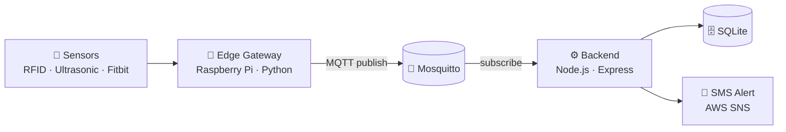

<div align="center">

<picture></picture>

<a href="https://github.com/aqqqas">
  
</a>

<br/>

<picture></picture>
<a href="https://github.com/aqqqas?tab=followers"></a>

</div>

<br/>

## 👾 About Me

```yaml
name: aqqqas
role: Backend Developer
focus:
  - 엣지 디바이스와 클라우드를 잇는 서버
  - 이벤트 기반 파이프라인 (MQTT → API → DB → Notification)
  - 컨테이너 기반 백엔드 · 인프라
currently: 백엔드 ↔ 인프라 연계 설계 연습 중
```

<br/>

## 🛠 Tech Stack

<div align="center">

**Languages & Frameworks**

<picture></picture>

**Data & Infra**

<picture></picture>

**Messaging & IoT**

<picture></picture>
<picture></picture>
<picture></picture>
<picture></picture>

**Tools**

<picture></picture>

</div>

<br/>

## 🚀 Featured Projects

<table>
  <tr>
    <td width="50%" valign="top">
      <h3>🏥 <a href="https://github.com/aqqqas/Cloud-IoT-Service.BE">Cloud-IoT-Service.BE</a></h3>
      <p>스마트 헬스케어 On-Premise 백엔드. 라즈베리파이가 MQTT로 보낸 섬망 이벤트를 수신해 <b>검증 → 디바이스 인증 → DB 저장 → 보호자 SMS 알림</b>까지 처리합니다.</p>
      <picture></picture>
      <picture></picture>
      <picture></picture>
      <picture></picture>
      <picture></picture>
    </td>
    <td width="50%" valign="top">
      <h3>📡 <a href="https://github.com/aqqqas/Cloud-IoT-Service.fallback-gateway">fallback-gateway</a></h3>
      <p>라즈베리파이 엣지 게이트웨이. RFID · 초음파 센서 · Fitbit 심박 데이터를 수집해 섬망 징후를 감지하고, 이벤트를 MQTT로 발행합니다.</p>
      <picture></picture>
      <picture></picture>
      <picture></picture>
      <picture></picture>
    </td>
  </tr>
  <tr>
    <td width="50%" valign="top">
      <h3>🐳 <a href="https://github.com/aqqqas/Backend-Practice">Backend-Practice</a></h3>
      <p>백엔드 ↔ 인프라 연계 개인 연습 프로젝트. FastAPI + PostgreSQL을 Docker Compose로 묶어 띄웁니다.</p>
      <picture></picture>
      <picture></picture>
      <picture></picture>
      <picture></picture>
    </td>
    <td width="50%" valign="top">
      <h3>🍚 <a href="https://github.com/aqqqas/bibim">bibim</a></h3>
      <p>비빔밥 스프링부트 세션 코드. JPA 기반 게시판 CRUD API와 Mustache 뷰로 구성된 Spring Boot 입문 프로젝트입니다.</p>
      <picture></picture>
      <picture></picture>
      <picture></picture>
    </td>
  </tr>
</table>

<br/>

## 🧩 Architecture I Build



<br/>

## 📊 GitHub Stats

<div align="center">

<picture></picture>
<picture></picture>

<picture></picture>

</div>

<br/>

## 🐍 Contribution Snake

<div align="center">

<picture>
  <source media="(prefers-color-scheme: dark)" srcset="https://raw.githubusercontent.com/aqqqas/aqqqas/output/github-snake-dark.svg"/>
  <source media="(prefers-color-scheme: light)" srcset="https://raw.githubusercontent.com/aqqqas/aqqqas/output/github-snake.svg"/>
  
</picture>

</div>

<br/>

<div align="center">

<picture></picture>

</div>
